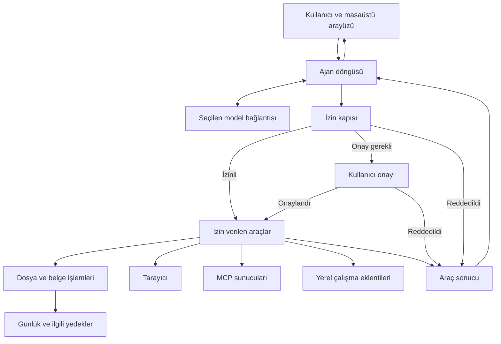

# Pevrai — ayrıntılı proje tanıtımı

**Belge tarihi:** 9 Ekim 2026  
**Kapsam:** Pevrai, Okuma Atölyesi, dönüştürücü araçları ve mevcut geliştirme durumu.

Bu belge projeyi ilk kez gören bir kullanıcı veya geliştirici için hazırlanmıştır.
Anlatım mevcut kaynak koduna, proje belgelerine ve 8 Ekim 2026'da doğrulanmış
yayınlara dayanır. Henüz yayımlanmayan kaynak değişiklikleri ayrıca belirtilir.

## 1. Pevrai nedir?

Pevrai, Windows üzerinde çalışan, dosyalar ve araçlarla iş yapabilen bir kişisel
yapay zekâ asistanıdır. Kullanıcı görevini doğal dille anlatır; uygulama seçilen
dil modelinden yararlanarak gerekli adımları belirler, izin verilen araçları
kullanır ve sonucu kullanıcıya sunar.

Örneğin kullanıcı, belirli bir klasördeki belgeleri karşılaştırmasını, bir konu
hakkında araştırma yapmasını veya okuduğu PDF'den çalışma notları hazırlamasını
isteyebilir. Pevrai'ın erişebileceği klasörleri, siteleri ve araçları kullanıcı
belirler. Riskli işlemler onay akışına girer; yasaklanan işlemler çalıştırılmaz.

Projenin adı **Personal Evolving Versatile Reasoning Artificial Intelligence**
kelimelerinin kısaltmasıdır. Buradaki gelişme fikri; kişisel çalışma düzenine,
araçlara, bağlama ve farklı model bağlantılarına uyarlanabilen bir asistanı
ifade eder. Uygulamanın kendiliğinden yeni bir temel model eğittiği anlamına gelmez.

Pevrai önceki **Limina** adıyla geliştirilen uygulamanın devamıdır. Ad değişirken
mevcut kurulumların ayar, sohbet ve anahtar kayıtlarıyla uyumluluk korunmuştur.

## 2. Projenin çözmeye çalıştığı ihtiyaç

Günlük bilgisayar işlerinde bilgi çoğu zaman farklı yerlerde dağınıktır:
PDF'lerde, klasörlerde, web sayfalarında, kişisel notlarda ve proje dosyalarında.
Kullanıcı bu bilgileri bulmak, okumak, bir araya getirmek ve yeniden düzenlemek
için tekrar tekrar benzer işlemler yapar.

Pevrai bu akışı tek bir çalışma ortamında toplar:

1. Kullanıcı görevini ve kullanılabilecek alanı belirler.
2. Asistan gerekli bağlamı izinli kaynaklardan toplar.
3. Araç çağrıları politika ve onay kontrolünden geçer.
4. İşlem adımları arayüzde izlenir; dosya değişiklikleri ilgili günlüklerde kaydedilir.
5. Sonuç belge, not, dosya veya açıklama olarak teslim edilir.

Hedef; araştırma, okuma ve dosya işleri sırasında kullanıcıya yardımcı olan,
eylemleri gözlemlenebilen ve erişimi sınırlandırılabilen bir masaüstü asistanıdır.

## 3. Projenin üç ana parçası

| Bileşen | Temel görev | Bağımsız kullanım |
| --- | --- | --- |
| **Pevrai** | Yapay zekâ sohbeti, görev yürütme, izin denetimi, araçlar, ekip ve çalışma eklentileri | Ana masaüstü uygulaması |
| **Okuma Atölyesi** | PDF kitaplığı, okuma, işaretleme, notlar ve DOCX belge editörü | Pevrai olmadan kullanılabilir |
| **Dönüştürücü** | Belgeler ve görseller arasında desteklenen dönüşümler | Kendi arayüzüyle veya MCP sunucusu olarak kullanılabilir |

Okuma Atölyesi ayrı bir uygulama ve ayrı GitHub deposudur. Pevrai ile bağlantısı
isteğe bağlıdır; temel okuma ve belge düzenleme işlemleri için bir yapay zekâ
hesabı gerekmez. Dönüştürücü ise araç katmanına bağlı bir bileşendir.

## 4. Pevrai'ın temel yetenekleri

### 4.1. Sohbet ve görev yürütme

Kullanıcı soru sorabilir veya araç gerektiren bir görev verebilir. Arayüz,
asistanın işlem adımlarını, araç sonuçlarını, onay taleplerini ve son yanıtını
gösterir. Görev çalışma sınırına ulaştığında devam için durum kaydı oluşturulabilir.

Sohbet geçmişi ve kişisel tercihler yerelde tutulur. Bir görevin hangi modelle
başlayacağı kullanıcı tarafından seçilebilir. Çalışma modları adım, araç çağrısı
ve istek bütçesini belirler; dosya veya site izinlerini genişletmez.

### 4.2. Dosya ve belge işlemleri

İzin verilen alanlarda klasör listeleme, metin arama, dosya okuma, yazma,
düzenleme, klasör oluşturma, taşıma ve yeniden adlandırma araçları bulunur.
Silme aracı dosyayı çöp alanına taşır.

Belge okuma katmanı PDF, DOCX, PPTX, XLSX ve CSV gibi biçimlerden metin elde
edebilir. Görseller ve taranmış sayfalar için uygun OCR bileşenleri kullanılabilir.
OCR'nin kullanılabilirliği işletim sistemi, kurulu bileşenler ve dil paketlerine bağlıdır.

Yerleşik dosya araçlarında ve paketle gelen dönüştürücünün ilgili çıktı
işlemlerinde günlük/yedek desteği vardır. Harici MCP araçlarının geri alma
kapsamı araca göre değişir; bütün harici işlemler için aynı güvence verilmez.

### 4.3. Tarayıcı araçları

Pevrai, Google Chrome'u kendi profiliyle kullanarak izinli sitelerde sayfa
açabilir, içerik okuyabilir, sayfa öğelerini inceleyebilir, tıklayabilir,
form alanlarını doldurabilir ve dosya indirebilir.

Site izinleri ve işlem türleri politika tarafından denetlenir. Parola ve kart
bilgisi girişine yönelik korumalar bulunur. Kullanıcının açık Chrome oturumunun
ve kişisel profilinin kullanılması temel çalışma yöntemi değildir.

### 4.4. Araç paketleri ve MCP

Yetenekler araç paketleri halinde yönetilir. Kullanıcı ihtiyaç duymadığı
paketleri kapatabilir; devre dışı araçların şemaları modele gönderilmez ve
izin kapısı bu araçları reddeder.

**MCP**, araç sunucularını bağlamak için kullanılan arayüzdür. Yeni bir sunucunun
araçları keşfedilebilir; kullanılmaları için risk sınıflarının belirlenmesi gerekir.
Bir sunucuyu eklemek, onun bütün araçlarına otomatik izin vermek anlamına gelmez.
Harici sunucu seçilirken sunucunun kendi davranışı ve yetkileri de değerlendirilmelidir.

## 5. Çoklu ajan ekibi ve 3B ofis

Pevrai, tek bir görevin farklı ajanlar arasında paylaşılabildiği bir ekip
çalışması sunar. Ajanların rolü, bağlantısı, modeli ve görünümü yapılandırılabilir.

Ekip akışında planlayıcı görevleri ve yazılacak yolları belirler. Kullanıcı,
hangi ajanın ne yapacağını ve hangi dosyalara yazacağını gösteren planı onaylar.
İşçiler ayrı süreçlerde, ana politikanın daraltılmış bir türeviyle çalışır.
Yazma alanlarının kesişmesi veya izinli çalışma alanının dışına çıkması plan
doğrulamasında reddedilir. Sonunda birleştirici, ortaya çıkan parçaları ve
raporları değerlendirerek sonucu toparlar.

Ajanlar bir pano üzerinden mesajlaşabilir; kullanıcı da bu panoya katkıda
bulunabilir. Ajan mesajları başka bir ajana yeni yetki kazandırmaz.

**3B ofis**, bu çalışmanın görsel ve etkileşimli görünümüdür. Ajan karakterleri
yaptıkları işin türüne göre masalara gider; çalışma, bekleme, hata ve onay
durumları görünür. Ajan kartından model/bağlantı/görünüm düzenlenebilir ve
mesaj gönderilebilir. Geçmiş koşular oynatılabilir.

Ofis hareketleri görev olaylarından üretilir. Görsel katman izin sistemini
değiştirmez. WebGL kullanılamadığında daha sade kart görünümü kullanılabilir.

## 6. Düşünce Ağı

Düşünce Ağı, fikirleri, kuralları ve dosyaları düğümler olarak bağlayan bir
bağlam düzenleme sistemidir. Bağlantılar ağırlık ve gecikme taşır; mantık
kapıları hangi düğümlerin etkinleşeceğini belirler.

Ağ ateşlendiğinde etkinleşen düğümler belirli bir sırayla bağlam üretir. Bu
yayılım dil modeli çağrısı yapmadan çalışır. Dosya düğümlerinin içeriğine erişim
normal okuma izinlerinden geçer.

Örneğin bir araştırma görevi için kaynak dosyaları, yazım kuralları ve bir
kontrol listesinin bağlantıları kurulabilir. Aynı düzen daha sonra yeniden
kullanılarak göreve tutarlı bir bağlam hazırlanabilir.

Asistan da ağ oluşturabilir; ajanın ürettiği içerik kullanıcı tarafından
benimsenene kadar işaretli ve güvenilmeyen kaynak olarak ele alınır. Bu sistem,
bir modelin ağırlıklarını eğitmekten ziyade hangi bilginin göreve hangi sırayla
taşınacağını düzenler.

## 7. Ders, odak, not ve proje eklentileri

Üç isteğe bağlı eklenti yerel çalışma düzenini destekler:

| Eklenti | İşlevler |
| --- | --- |
| **Study & Focus** | Ders, sınav ve konu kayıtları; çalışma planları; Pomodoro ve serbest odak oturumları |
| **Smart Notes** | Aranabilir/etiketlenebilir notlar, kayıtlar arası bağlantılar, taslaklar, sürüm geçmişi ve geri yükleme |
| **Workspace** | Proje amacı, görevler, dosya/çıktı bağlantıları, günlük ve sonraki adımlar |

Temel panel işlemleri yerel veritabanlarıyla çalışır ve model çağrısı gerektirmez.
Asistanın eklenti araçlarını kullanması normal izin ve onay akışına tabidir.
Bir eklentiyi kapatmak, kayıtlarını silmek anlamına gelmez.

Bir projede **Sohbette devam et** seçildiğinde sınırlı proje bağlamı sohbete
eklenir. Proje kaydı oluşturmak yeni dosya erişim izni sağlamaz; proje dosyaları
gerektiğinde normal okuma kontrolüyle açılır.

## 8. Okuma Atölyesi

Okuma Atölyesi, PDF belgeleri düzenli bir kitaplıkta tutan ve okuma sırasında
işaretleme yapmayı sağlayan bağımsız bir masaüstü uygulamasıdır.

Başlıca özellikleri:

- Kitaplık, raf/koleksiyon, etiket ve favori yönetimi.
- Belgelerde tam metin arama ve son okuma konumundan devam.
- Metin seçimi, kalem, fosfor, alt çizgi, kutu, ok, not ve yer imi.
- İşaretlemeleri içeren yeni PDF çıktısı üretme.
- PDF birleştirme, sayfa düzenleme, OCR ve kitaplık yedekleme/geri yükleme.
- DOCX belge oluşturma ve düzenleme: biçimlendirme, listeler, tablolar,
  görseller, sayfa düzeni, üst/alt bilgi, yazdırma ve PDF çıktısı.
- Gerektiğinde belgeyi LibreOffice ile açma.

Belge editörünün destekleyemediği içeriklerde veri kaybını önlemeye yönelik
korumalar bulunur. Tam bir Word özellik eşitliği varsayılmamalıdır.

### Pevrai ile birlikte kullanım

Okuyucunun asistan panelinden seçili metin için **Açıkla**, **Özetle**,
**Çevir** veya **Soru hazırla** isteği gönderilebilir. İşlem Pevrai'ın mevcut
ajan döngüsünde yürür; yanıt belge ve sayfa kaynağıyla okuyucuya döner.
Okuyucuya ayrıca model API anahtarı girilmez.

Seçim yoksa açık sayfanın sınırlı bir metin parçası kullanılabilir. Metni
olmayan taranmış sayfalarda önce OCR gerekir. Araç onayları ve çalışan isteğin
durdurulması Pevrai tarafından yönetilir; okuyucudaki iptal bekleyen isteğe yöneliktir.

Seçim veya yanıt Smart Notes'a kaydedilebilir ve bir Workspace projesine
bağlanabilir. Kaynak bağlantısı ilgili PDF sayfasını tekrar açmayı sağlar.
MCP sunucusu, izinleri uygun başka asistanların da kitaplıkla çalışmasına olanak verir.

## 9. Dönüştürücü

Dönüştürücü hem bir arayüz hem MCP sunucusu üzerinden kullanılabilir. Mevcut
dönüşüm tablosunda şu eşleşmeler bulunur:

| Girdi | Çıktı |
| --- | --- |
| PPTX / PPT | PDF |
| DOCX | PDF |
| Markdown / TXT | PDF |
| PDF | PPTX veya PNG |
| PNG / JPG / JPEG | PDF |

Bazı dönüşümler LibreOffice gibi ek bileşenlere ihtiyaç duyar. Dönüşümün
desteklenmesi, bütün kaynak biçimlendirmesinin eksiksiz korunacağı anlamına gelmez.
Özellikle Markdown/TXT → PDF yolunda Markdown işaretleri metin olarak korunur;
tam bir Markdown sayfa düzeni motoru kullanılmaz.

## 10. Teknik mimari

Pevrai'ın çekirdeği Python ile yazılmıştır. Masaüstü penceresi pywebview
üzerinden yerel HTML/JavaScript arayüzünü açar. Okuma Atölyesi ise PySide6/Qt
tabanlı ayrı bir uygulamadır.



Temel parçaların görevleri:

| Kaynak | Sorumluluk |
| --- | --- |
| `pevrai/vekil_v0.py` | Ajan döngüsü, model/araç turları ve çalışma sınırları |
| `pevrai/gate.py` | Politika, yol ve işlem kararları |
| `pevrai/model/`, `model_zinciri.py` | Sağlayıcı adaptörleri ve model geçişleri |
| `pevrai/journal.py` | İşlem kayıtları, ilgili yedek/çöp ve geri alma bilgileri |
| `pevrai/pencere.py`, `arayuz/` | Masaüstü köprüsü ve kullanıcı arayüzü |
| `pevrai/ekip.py`, `ofis.py` | Ekip planlama/işçiler ve ofis olayları |
| `pevrai/ag.py` | Düşünce Ağı |
| `pevrai/mcp_bridge.py` | Harici araç sunucularıyla bağlantı |
| `pevrai/okuma.py` | Okuma Atölyesi bağlantısı |
| `pevrai/eklentiler/` | Ders, not ve proje servisleri |
| `packaging/` | Windows paketleme ve paket doğrulaması |

Model önerdiği araç çağrısını doğrudan işletim sisteminde yürütmez. Çağrı önce
izin katmanına girer. Başarı, ret ve hata sonuçları görev döngüsüne geri döner;
asistan bu sonuca göre devam edebilir veya işlemi sonlandırabilir.

## 11. Güvenlik ve veri akışı

### İzinler

- **Varsayılan ret:** tanımsız veya kapatılmış bir araç kendiliğinden yetki kazanmaz.
- **Ayrı okuma/yazma kökleri:** bir klasörü okuyabilmek ona yazabilmek anlamına gelmez.
- **Yol denetimi:** izinli köklerin dışına çıkma ve hassas dosya erişimleri sınırlandırılır.
- **Onay:** riskli işlemlerde kullanıcı kararı gerekir; onay reddi sessizce kabul edilmez.
- **Dar ekip politikası:** işçiler ana kullanıcının dosya yetkilerini genişletemez.

Pevrai'ın genel kabuk veya modelin ürettiği kodu çalıştırma aracı yoktur.
Kullanıcının belirlediği açma klasöründeki dosya/kısayol/uygulamalar için ayrı
ve onaylı açma akışı vardır; bu akış genel bir komut çalıştırıcı değildir.

Web sayfası, belge, araç sonucu ve ajan mesajı güvenilmeyen veri olarak ele
alınır. Bu içeriklerdeki “önceki talimatları unut” benzeri metinler yeni kullanıcı
talimatı veya yeni bir izin kaynağı sayılmaz. Modelin yanıt doğruluğu yine de
kullanıcı tarafından, özellikle önemli karar ve çıktılarda kontrol edilmelidir.

### Yerel saklama ve dış bağlantılar

Sohbetler, ayarlar, günlükler, notlar ve ilgili yedekler yerelde tutulur.
Ancak **yerel saklama, bütün işlemlerin çevrimdışı olduğu anlamına gelmez**:

- Bulut modeli seçildiğinde isteğin metni ve göreve eklenen bağlam o sağlayıcıya gönderilir.
- Yerel model sunucusu seçilebilir; bunun erişim adresi ve çalışma ortamı kullanıcıya bağlıdır.
- Tarayıcı araçları izin verilen web sitelerine bağlanır.
- İsteğe bağlı günlük güncelleme denetimi GitHub sürüm bilgisini sorgular.
- Harici MCP sunucusunun kendi ağ ve veri davranışı olabilir.

API anahtarları politika dosyasına veya sohbet günlüğüne yazılmaz; sistem
anahtar deposu ya da yerel kimlik dosyası üzerinden yönetilir. Yerel dosyada
saklama seçeneği, kendiliğinden şifreli depolama güvencesi olarak yorumlanmamalıdır.

## 12. Model bağlantıları ve maliyet

Pevrai; Gemini, Anthropic ve OpenAI uyumlu adaptörlerle farklı servislerle
çalışabilir. Uygun OpenAI uyumlu uç noktalar üzerinden yerel model sunucuları
da bağlanabilir. Desteklenen gerçek modeller ilgili sunucu ve hesapta bulunan
modellere bağlıdır.

Birden fazla bağlantı ve model sıraya konabilir. Uygun kullanım sınırı
durumlarında görev, araç geçmişiyle birlikte sıradaki modele geçebilir.
Bu geçiş diğer dosya/site izinlerini değiştirmez.

Görev modları ve istek sınırları çalışma miktarını kontrol eder. Bir API
sağlayıcısının fiyatı, kullanım limiti ve hesap bakiyesi Pevrai'dan ayrı
yönetilir. Yerel günlük kota sayacının hata ve eşzamanlılık durumlarında
güçlendirilmesi hâlâ geliştirme önceliğidir; mevcut sayaç tek başına kesin bir
maliyet tavanı garantisi olarak kullanılmamalıdır.

## 13. Örnek kullanım senaryoları

| Senaryo | Örnek istek | Kullanıcının hazırlığı |
| --- | --- | --- |
| Belgeleri karşılaştırma | “Bu klasördeki raporların ortak ve farklı bulgularını tabloya çıkar.” | Kaynak klasörüne okuma izni; çıktı için uygun yazma alanı |
| Okuma ve çalışma | “Seçtiğim paragrafı açıkla ve beş tekrar sorusu hazırla.” | Okuma Atölyesi'nde metin seçimi ve Pevrai bağlantısı |
| Dosya düzenleme | “Bu dosyaları konularına göre düzenlemek için plan öner.” | Dar çalışma klasörü; uygulanacak değişikliklerin incelenmesi/onayı |
| Web araştırması | “İzin verdiğim sitelerde bu konuyu araştırıp kaynaklı bir taslak hazırla.” | Site izinleri ve çıktı klasörü |
| Ekip çalışması | “Kaynak özeti, karşılaştırma ve sonuç taslağını ekiple hazırlayalım.” | Tanımlı ajanlar ve dosya paylaşım planının onayı |
| Proje devamı | “Bu projenin son notlarından ve görevlerinden devam et.” | Workspace seçimi ve gerektiğinde dosya erişimi |

Bunlar örnek iş akışlarıdır. Sonucun kalitesi modelin yeteneğine, kaynakların
niteliğine, kurulu araçlara ve verilen izinlere bağlıdır.

## 14. Kurulum ve ilk kullanım

### Hazır Windows kurulumu

Pevrai'ın Windows kurulumu Python yüklemeyi gerektirmez. İlk sürümlerin hedefi
Windows 10/11, 64-bit ortamdır. Tarayıcı araçları için Google Chrome;
bazı belge dönüşümleri için LibreOffice gerekir. Kurulumlar henüz kod imzalı değildir.

8 Ekim 2026'da doğrulanan kurulumlar:

- [Pevrai 0.1.1](https://github.com/ledaronn/pevrai/releases/tag/v0.1.1).
- [Okuma Atölyesi 1.1.1](https://github.com/ledaronn/okuma-atolyesi/releases/tag/v1.1.1).

Sürüm sayfalarında setup dosyası ve `SHA256SUMS.txt` bulunur. İlk kullanımda
dil, çalışma klasörleri, araçlar, görünüm ve model bağlantısı yapılandırılır.
Hiçbir çalışma klasörü zorunlu değildir; yazma izni verilmeyen durumda asistan
dosya oluşturamaz.

Güncelleme bildirimi isteğe bağlıdır. Açılışta en fazla 24 saatte bir yeni
kararlı sürüm kontrol edilir; indirme ve kurulum kullanıcı tarafından yapılır.
Kaldırma ayar ve sohbetleri koruyacak şekilde tasarlanmıştır; gerçek temiz
kurulum/yükseltme/kaldırma kabul denemelerinin tamamı henüz yapılmamıştır.

### Geliştirici olarak kaynaktan çalışma

Python 3.11 veya daha yeni bir sürüm gerekir. Aşağıdaki örnek, yeni bir
geliştirme kopyasının kökünde PowerShell ile çalıştırılabilir:

```powershell
python -m venv .venv
.venv\Scripts\python.exe -m pip install -e '.[tam]'
.venv\Scripts\python.exe -m pevrai
```

`[tam]` isteğe bağlı bileşenleri de kurar. Daha sınırlı bir kurulum için proje
bağımlılık grupları incelenebilir. Okuma Atölyesi ayrı sanal ortam ve kendi
bağımlılık dosyasıyla çalıştırılır.

## 15. Doğrulama ve geliştirme durumu

### Yayımlanan sürümlerde doğrulananlar

8 Ekim yayın sürecinde Pevrai'ın **39 kaynak test paketi** geçti. Okuma
Atölyesi'nde **77 test geçti**, Tesseract eksikliği nedeniyle bir OCR testi atlandı.
Paketlenmiş sürüm, MCP ve ilgili tanılama/çizim kontrolleri başarılı oldu.
Her iki setup indirildi; yerel SHA256, özet dosyası ve GitHub asset özeti eşleşti.

Paket doğrulaması süre ve yanıt boyutu sınırları kullanır; ayrı geçici veri
klasörlerinde çalışır ve yalnızca başlattığı süreçleri kapatır. Kaynak testleri
release işinde kurulum üretiminden önce çalıştırılır.

### Henüz yalnızca yerel kaynakta bulunan değişiklikler

- Okuyucunun kalemlik/focus-mode testi animasyon ve yerleşimin bitmesini
  bekliyor; normal ve yavaş animasyonla iki hedefli test geçti.
- Pevrai'ın `--tani` çıktısı kişisel yolları ve ham hata metinlerini gizliyor.
- `--tani-ayrintili` açık bir yerel ayrıntı seçeneği sunuyor; çıktı kişisel
  bilgiler içerebileceği konusunda uyarıyor.
- Eksik isteğe bağlı paketler ve bir sağlayıcının anahtar okuma hatası
  diğer tanı kontrollerini durdurmuyor.
- Sürüm, tanı gizliliği ve paket denetimini kapsayan **14 hedefli test** geçti.

Bu ek değişiklikler **yayımlanmış Pevrai 0.1.1 kurulumunda henüz bulunmuyor**.
Yeni paket/CI doğrulaması ve yetkili bir sonraki yayın gerekir. Mevcut
tanıtım belgesinin hazırlanması sırasında commit veya push yapılmamıştır.

### Açık işler

1. Kota hakkının atomik ve süreçler arasında zorunlu kilitli ayrılması;
   bozuk/yazılamayan sayaçta sınırlı isteğin durdurulması.
2. Yerel kaynak değişikliklerinin tam CI ve GitHub paket doğrulamasından geçirilmesi.
3. Gerçek Chrome/CDP test ortamının yerelde tekrarlanabilir hale getirilmesi.
4. Ayrı Windows test ortamında temiz kurulum, yükseltme ve kaldırma kabulü.
5. OCR'nin gerekli bileşenlerin bulunduğu ortamda doğrulanması.
6. Belge/test kapsamının güncellenmesi ve eksik depo bakım kontrolleri.
7. Harici yedek, isteğe bağlı kod imzalama ve logo kararının değerlendirilmesi.

Güncel teknik iş sırası [iyileştirme planında](IYILESTIRME_PLANI.md) yer alır.
Bu belge özellikleri tanıtır; bütün açık işlerin kapandığına ilişkin bir kabul raporu değildir.

## 16. Depolar, lisanslar ve ek belgeler

| Proje | Depo | Depodaki lisans |
| --- | --- | --- |
| Pevrai | [ledaronn/pevrai](https://github.com/ledaronn/pevrai) | [MIT](../LICENSE) |
| Okuma Atölyesi | [ledaronn/okuma-atolyesi](https://github.com/ledaronn/okuma-atolyesi) | [AGPL-3.0](https://github.com/ledaronn/okuma-atolyesi/blob/main/LICENSE) |

Ayrıntı için:

- [Türkçe başlangıç rehberi](README.tr.md).
- [Mimari](ARCHITECTURE.md).
- [Ekip ve çoklu ajan sistemi](EKIP.md).
- [Düşünce Ağı](AG.md).
- [Ders, not ve proje eklentileri](PRODUCTIVITY.md).
- [Okuma Atölyesi bağlantısı](OKUMA_INTEGRATION.md).
- [Ad değişikliği ve mevcut veriler](AD_DEGISIKLIGI.md).
- [İyileştirme planı](IYILESTIRME_PLANI.md).
